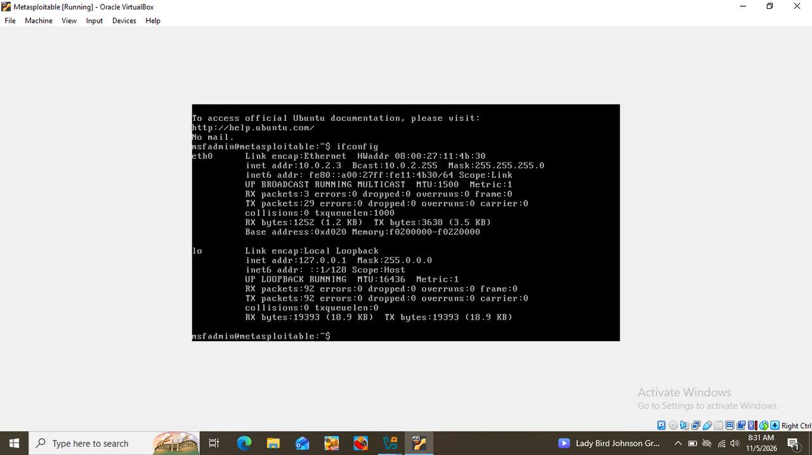
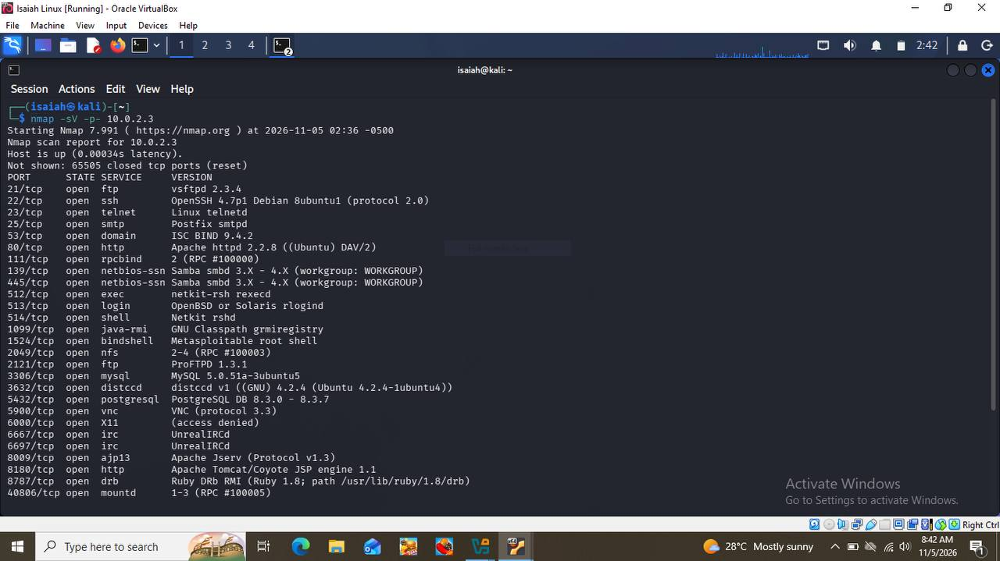
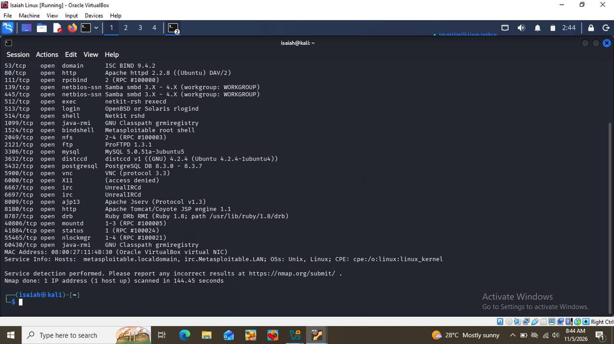
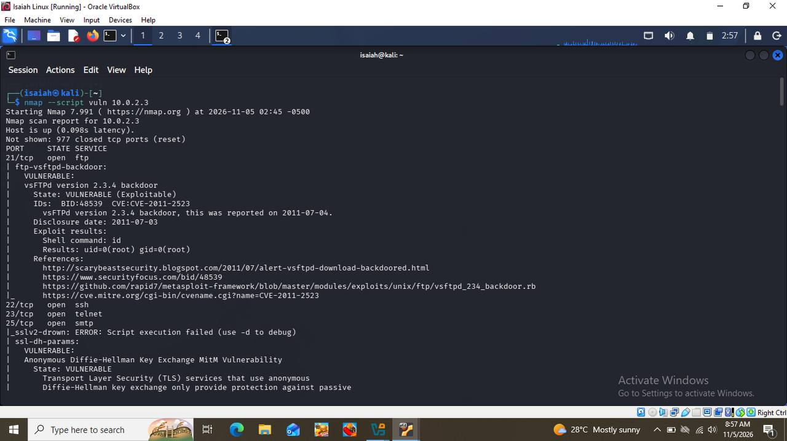
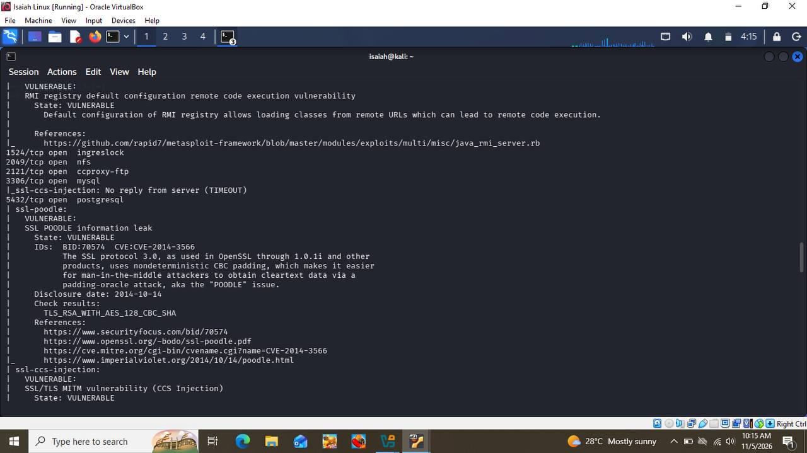
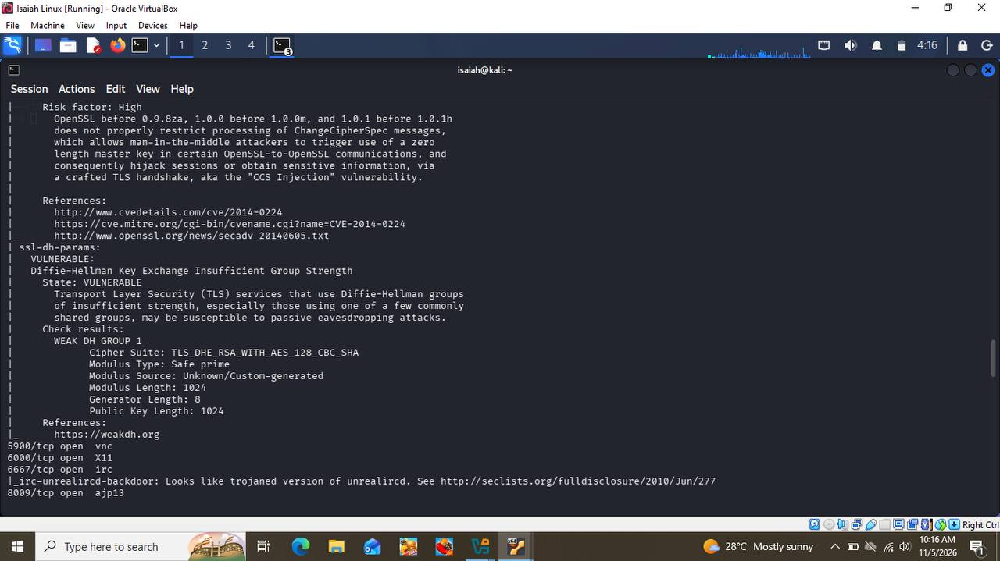
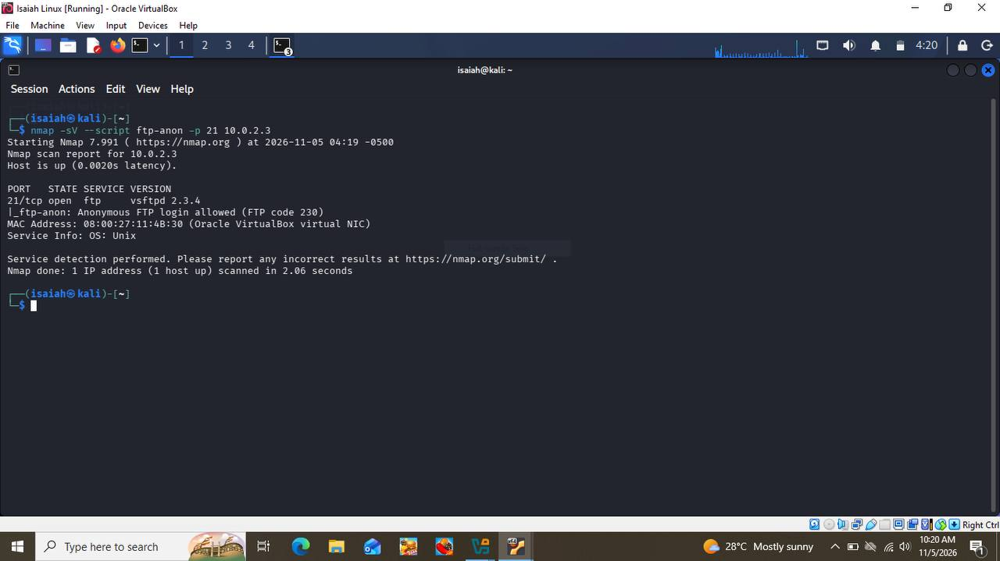
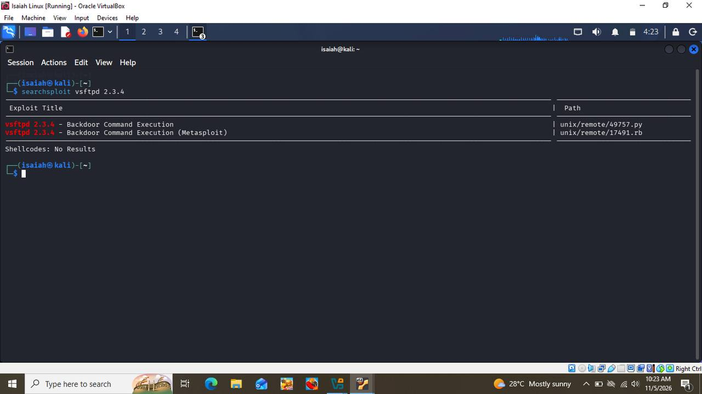
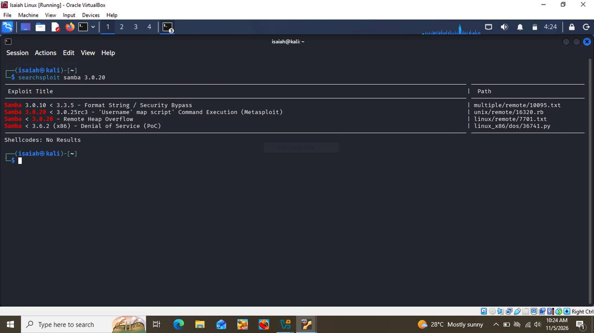
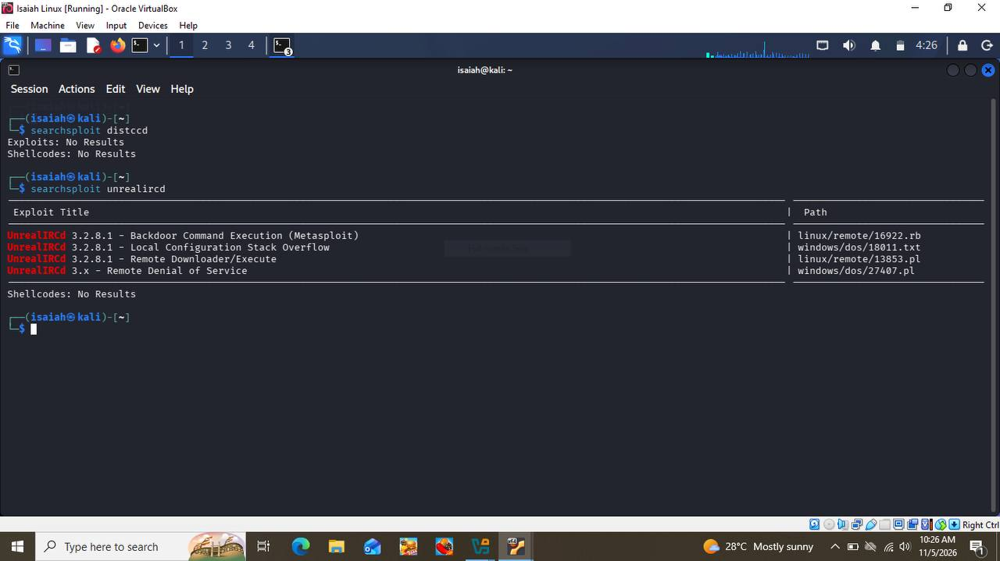

# From Vulnerability to Compliance: Securing Legacy and Cloud Systems at HanTech

### Professional Security Assessment Report — TS Academy Cybersecurity Capstone Project

**Prepared For:** HanTech Management &nbsp;|&nbsp; **Date:** November 2026 &nbsp;|&nbsp; **Group 53 (Hajime Cohort)**

---

## Table of Contents

- [Executive Summary](#executive-summary)
- [1. Introduction and Scope](#1-introduction-and-scope)
- [2. Vulnerability Findings (V1–V5)](#2-vulnerability-findings-v1v5)
  - [2.1 Environment and Attack Surface](#21-environment-and-attack-surface)
  - [2.2 Findings at a Glance](#22-findings-at-a-glance)
  - [2.3 V1: vsftpd 2.3.4 Backdoor Command Execution](#23-v1-vsftpd-234-backdoor-command-execution)
  - [2.4 V2: UnrealIRCd 3.2.8.1 Backdoor Command Execution](#24-v2-unrealircd-3281-backdoor-command-execution)
  - [2.5 V3: Samba Username Map Script Command Execution](#25-v3-samba-username-map-script-command-execution)
  - [2.6 V4: Anonymous FTP Login Enabled](#26-v4-anonymous-ftp-login-enabled)
  - [2.7 V5: Weak SSL and TLS Encryption](#27-v5-weak-ssl-and-tls-encryption)
- [3. Risk Assessment](#3-risk-assessment)
- [4. Recommended Security Controls](#4-recommended-security-controls)
- [5. Recommended GRC Policies](#5-recommended-grc-policies)
- [6. Cloud Security Fundamentals](#6-cloud-security-fundamentals)
- [7. 90-Day Remediation Roadmap](#7-90-day-remediation-roadmap)
- [8. Additional Observations](#8-additional-observations)
- [9. Conclusion](#9-conclusion)
- [Appendix A: Evidence Index & Appendix B: References](#appendix-a-evidence-index--appendix-b-references)

---

## Executive Summary

HanTech engaged our consulting team (**Group 53 — Hajime Cohort**) to review a legacy system discovered inside its environment, **Metasploitable 2** (`10.0.2.3`), and explain in plain business terms what is wrong, why it matters to the organization, and what should be done. We scanned the system and found **30 open network services** running simultaneously, many outdated and several containing critical known flaws. Five high-impact vulnerabilities were analyzed in depth.

- **30** open TCP network services discovered
- **5** core vulnerabilities analyzed in depth (**2 Critical**, **2 High**, **1 Medium**)
- **10** layered security controls and **6** GRC policies recommended

### Key Findings and Highest Risks

| What We Found | What It Means for the Business | Risk Rating |
| :--- | :--- | :--- |
| **Planted backdoor in the FTP file service (`vsftpd 2.3.4`)** | A hidden entrance that lets an external attacker take full root control of the server without a password. |  |
| **Planted backdoor in the chat service (`UnrealIRCd 3.2.8.1`)** | A second tampered service allowing remote attackers to execute operating system commands without logging in. |  |
| **File sharing command execution flaw (`Samba`)** | The file sharing service can be tricked via crafted usernames into running an attacker's arbitrary commands. |  |
| **Weak encryption on database and email traffic (`SSL/TLS`)** | Private data in transit can be intercepted, decrypted, or altered by an attacker on the network. |  |
| **Anonymous FTP login enabled** | Anyone on the network can log into the file transfer service without credentials or accountability. |  |

- **Business Risk:** An attacker reaching these exposed services could steal or alter customer data, shut down operations, pivot into HanTech's cloud workloads, damage company reputation, and expose HanTech to penalties under data protection laws. Both Critical items require no password and no advanced skill to exploit because public attack modules already exist.
- **Recommended Controls:** Remove and replace backdoored software with clean, checksum-verified versions; upgrade Samba and remove unsafe script options; switch off anonymous FTP access; close unnecessary services; and restrict access with firewall rules, strong TLS 1.2/1.3 encryption, and MFA (Section 4).
- **Recommended Policies:** *Vulnerability Management*, *Patch Management*, *Access Control*, *Secure Configuration and Hardening*, *Cryptography and Encryption*, and *Network Security* (Section 5).
- **Overall Security Posture — HIGH RISK (Urgent Action Needed):** In its current state, this system must not hold real data or sit on a network that reaches corporate or cloud systems. Because active backdoors were confirmed, it must be treated as potentially compromised, isolated immediately, and rebuilt from a trusted baseline image.

---

## 1. Introduction and Scope

### 1.1 Background and Purpose
HanTech is a medium-sized technology company providing digital platform and data services to its clients, including cloud-hosted workloads. Its internal security team discovered a legacy system running inside the environment with multiple weaknesses. Management is concerned about unauthorized access, data breaches, service disruption, regulatory violations, and reputational damage.

Our team was engaged as Junior Cybersecurity Consultants. Rather than performing destructive exploitation, this report explains what vulnerabilities exist, why they matter, and what should be done to reduce risk using Governance, Risk Management, and Compliance (GRC) principles and cloud security fundamentals.

### 1.2 Scope, Environment and Method

| Parameter | Assessment Details |
| :--- | :--- |
| **Client** | HanTech (medium-sized digital platform and data services provider) |
| **System Reviewed** | Metasploitable 2 legacy Linux system (`10.0.2.3`) |
| **Assessment Workstation** | Kali Linux Virtual Machine (Oracle VirtualBox) |
| **Tools & Databases Used** | `Nmap 7.991` (port, service, and NSE vulnerability scripts), `Searchsploit` (Exploit-DB lookup), and NIST National Vulnerability Database (`NVD`) for CVE/CVSS scoring |
| **Date of Scans** | 5 November 2026 |
| **Results** | 30 open TCP ports, 5 core vulnerabilities selected for full analysis, 8 additional observations |
| **Approach & Ethics** | Non-destructive detection and analysis only. No exploit payloads were executed against unauthorized targets and no data was modified. |

---

## 2. Vulnerability Findings (V1–V5)

### 2.1 Environment and Attack Surface
The target system was reached at `10.0.2.3` (**Figure 1**). A full port scan with service and version detection (`nmap -sV -p- 10.0.2.3`) identified **30 open TCP ports**, including cleartext remote access services (`Telnet`, `rexec`, `rlogin`, `rsh`), database servers (`MySQL 5.0.51a`, `PostgreSQL 8.3.0–8.3.7`), file sharing (`Samba`), web servers (`Apache 2.2.8`, `Tomcat`), and an exposed `bindshell` root shell on port `1524/tcp` (**Figures 2 and 3**).

**Figure 1:** Target system (`Metasploitable 2`) showing its network address `10.0.2.3`

**Figure 2:** Nmap service and version detection results (`nmap -sV -p- 10.0.2.3`), part one

**Figure 3:** Nmap results, part two, completing the list of 30 open TCP services

---

### 2.2 Findings at a Glance

| ID | Vulnerability | Affected Service | CVE | Port(s) | Rating |
| :--- | :--- | :--- | :--- | :--- | :--- |
| **V1** | `vsftpd 2.3.4` backdoor | FTP (`vsftpd 2.3.4`) | `CVE-2011-2523` | `21/tcp` | **Critical** |
| **V2** | `UnrealIRCd 3.2.8.1` backdoor | IRC (`UnrealIRCd`) | `CVE-2010-2075` | `6667/tcp`, `6697/tcp` | **Critical** |
| **V3** | Samba username map script command execution | SMB (`Samba smbd`) | `CVE-2007-2447` | `139/tcp`, `445/tcp` | **High** |
| **V4** | Anonymous FTP login enabled | FTP (`vsftpd 2.3.4`) | `CVE-1999-0497` | `21/tcp` | **Medium** |
| **V5** | Weak SSL and TLS encryption (CCS Injection, POODLE, Logjam) | PostgreSQL & Postfix SMTP | `CVE-2014-0224` | `5432/tcp`, `25/tcp` | **High** |

---

### 2.3 V1: vsftpd 2.3.4 Backdoor Command Execution

| Field | Details |
| :--- | :--- |
| **Vulnerability Name** | `vsftpd 2.3.4` backdoor (`CVE-2011-2523`) |
| **Affected Service** | FTP file transfer service, `vsftpd 2.3.4`, port `21/tcp` |
| **Brief Description** | Copies of `vsftpd 2.3.4` downloaded from the official site in July 2011 were tampered with to include hidden backdoor code that opens a root command shell when triggered, without requiring valid login credentials. |
| **Potential Attacker Goal** | Gain unauthenticated remote administrator (`root`) access, steal or alter data, install persistent backdoors, and pivot laterally to other HanTech systems. |
| **Evidence** | Nmap NSE script `ftp-vsftpd-backdoor` reported `VULNERABLE (Exploitable)` under `CVE-2011-2523` and confirmed `uid=0(root) gid=0(root)` (**Figure 4**). Searchsploit lists two public exploit modules (**Figure 5**). |
| **Risk Rating** | **Critical** (`CVSS v3.1: 9.8`) |

**Figure 4:** Nmap confirms the `vsftpd 2.3.4` backdoor on port `21/tcp` and returns root-level access

**Figure 5:** Searchsploit shows public exploit code exists for `vsftpd 2.3.4`

---

### 2.4 V2: UnrealIRCd 3.2.8.1 Backdoor Command Execution

| Field | Details |
| :--- | :--- |
| **Vulnerability Name** | `UnrealIRCd` trojaned (backdoored) release (`CVE-2010-2075`) |
| **Affected Service** | IRC chat server, `UnrealIRCd`, ports `6667/tcp` and `6697/tcp` |
| **Brief Description** | Between November 2009 and June 2010, download mirrors distributed `UnrealIRCd 3.2.8.1` source archives containing a covert Trojan horse that lets remote attackers execute operating system commands without logging in. |
| **Potential Attacker Goal** | Execute arbitrary remote commands, establish a foothold inside the network, harvest credentials, add the server to a botnet, or pivot to high-value assets. |
| **Evidence** | Nmap script `irc-unrealircd-backdoor` reported `"Looks like trojaned version of unrealircd"` on port `6667/tcp` (**Figure 6**). Searchsploit lists a public Metasploit remote execution module (**Figure 7**). |
| **Risk Rating** | **Critical** (`CVSS v2: 7.5` — elevated to Critical due to planted backdoor) |

**Figure 6:** Nmap detects a trojaned `UnrealIRCd` on port `6667/tcp` (bottom) and CCS Injection (top)

**Figure 7:** Searchsploit results for `distccd` and `UnrealIRCd`, including the backdoor command execution module

---

### 2.5 V3: Samba Username Map Script Command Execution

| Field | Details |
| :--- | :--- |
| **Vulnerability Name** | Samba `usermap` script remote command execution (`CVE-2007-2447`) |
| **Affected Service** | SMB file and printer sharing, `Samba smbd`, ports `139/tcp` and `445/tcp` |
| **Brief Description** | In Samba `3.0.0` through `3.0.25rc3`, the `username map script` feature passes user-supplied input directly to `/bin/sh` without sanitization, allowing unauthenticated attackers to execute arbitrary commands via shell metacharacters in a username. |
| **Potential Attacker Goal** | Execute commands on the file server, read or modify shared files, collect password hashes, and spread laterally to internal workstations. |
| **Evidence** | Nmap identified `Samba smbd 3.X - 4.X` on ports `139/tcp` and `445/tcp` (**Figures 2 and 3**), and Searchsploit confirmed a public Metasploit RCE module (`unix/remote/16320.rb`) for Samba `< 3.0.25rc3` (**Figure 8**). |
| **Risk Rating** | **High** (`CVSS v2: 6.0` — rated High due to unauthenticated RCE exploitability) |

**Figure 8:** Searchsploit shows several public exploits for `Samba 3.0.20`

---

### 2.6 V4: Anonymous FTP Login Enabled

| Field | Details |
| :--- | :--- |
| **Vulnerability Name** | Anonymous FTP access (`CVE-1999-0497`) |
| **Affected Service** | FTP file transfer service, `vsftpd 2.3.4`, port `21/tcp` |
| **Brief Description** | The FTP server accepts logins from anyone using the public username `anonymous` without a valid password, removing user identity and accountability on an internal business server. |
| **Potential Attacker Goal** | Browse and download exposed directories, upload malicious files for staging deeper attacks, and enumerate internal system information. |
| **Evidence** | Nmap script `ftp-anon` returned `"Anonymous FTP login allowed (FTP code 230)"` on port `21/tcp` (**Figure 9**). |
| **Risk Rating** | **Medium** (`CVSS v2: 5.0`) |

**Figure 9:** Nmap confirms that anonymous FTP login is allowed on port `21/tcp`

---

### 2.7 V5: Weak SSL and TLS Encryption

| Field | Details |
| :--- | :--- |
| **Vulnerability Name** | SSL/TLS CCS Injection (`CVE-2014-0224`), POODLE (`CVE-2014-3566`), and Logjam (`CVE-2015-4000`) |
| **Affected Service** | PostgreSQL database (`5432/tcp`) and Postfix SMTP mail service (`25/tcp`) |
| **Brief Description** | Both services rely on outdated OpenSSL versions and weak cryptographic settings: ChangeCipherSpec (CCS) Injection, legacy SSL 3.0 padding-oracle exposure (POODLE), and weak 512-bit/1024-bit Diffie-Hellman key exchange groups (Logjam). |
| **Potential Attacker Goal** | Perform Man-in-the-Middle (MitM) attacks to decrypt database queries, intercept emails and credentials, hijack sessions, or tamper with data in transit. |
| **Evidence** | Nmap marked `ssl-ccs-injection` and `ssl-poodle` as `VULNERABLE` on port `5432/tcp` (**Figure 10** and **Figure 6**), alongside weak Diffie-Hellman groups across ports `25/tcp` and `5432/tcp`. |
| **Risk Rating** | **High** (`CVSS v3: 7.4`) |

**Figure 10:** Nmap flags RMI, POODLE, and SSL/TLS CCS Injection as `VULNERABLE` on PostgreSQL, port `5432/tcp`

---

## 3. Risk Assessment

Risk was evaluated using **Risk = Likelihood × Impact**, anchored to NIST NVD CVE identifiers, published CVSS base scores, and HanTech's operational exposure.

### 3.1 Rating Scale

| Rating | CVSS Guide | Meaning and Response SLA |
| :--- | :--- | :--- |
| **Critical** | `9.0 – 10.0` | Complete takeover is easy, requires no login, and public attack tools exist. Fix or isolate immediately (**within 7 days**). |
| **High** | `7.0 – 8.9` | Serious confidentiality, integrity, or availability harm is likely if abused. Fix **within 30 days**. |
| **Medium** | `4.0 – 6.9` | Meaningful harm is possible or abuse requires specific network conditions. Fix **within 60 days**. |
| **Low** | `0.1 – 3.9` | Limited harm. Fix during routine maintenance windows. |

### 3.2 Risk Register & Rationale

| ID | Vulnerability | CVE | CVSS | Likelihood | Impact | Overall Rating | Rationale Summary |
| :--- | :--- | :--- | :--- | :--- | :--- | :--- | :--- |
| **V1** | `vsftpd 2.3.4` backdoor | `CVE-2011-2523` | `9.8` (v3.1) | High | Critical | **Critical** | Directly reachable, zero authentication, public exploits, full `root` shell confirmed by Nmap. |
| **V2** | `UnrealIRCd` backdoor | `CVE-2010-2075` | `7.5` (v2) | High | Critical | **Critical** | Deliberately planted backdoor with a ready-made Metasploit module enabling unauthenticated RCE. |
| **V3** | Samba username map script | `CVE-2007-2447` | `6.0` (v2) | High | High | **High** | File sharing ports are exposed internally and public Metasploit RCE tools make exploitation trivial. |
| **V4** | Anonymous FTP login | `CVE-1999-0497` | `5.0` (v2) | High | Medium | **Medium** | Anyone reaching port 21 can log in without a password; impact depends on exposed/writable files. |
| **V5** | Weak SSL/TLS (CCS Injection) | `CVE-2014-0224` | `7.4` (v3) | Medium | High | **High** | Requires a network MitM position, but exposes sensitive database queries, mail, and credentials. |

### 3.3 Risk Heat Map

| Likelihood \ Impact | Impact: Low | Impact: Medium | Impact: High | Impact: Critical |
| :--- | :--- | :--- | :--- | :--- |
| **Likelihood: High** | Medium | **Medium (`V4`)** | **High (`V3`)** | **Critical (`V1`, `V2`)** |
| **Likelihood: Medium** | Low | Medium | **High (`V5`)** | High |
| **Likelihood: Low** | Low | Low | Medium | Medium |

---

## 4. Recommended Security Controls

We recommend **two layered controls (Defense in Depth)** for every vulnerability—one corrective/preventive fix at the root cause, and one secondary control to limit blast radius:

| Vulnerability | Control 1 (Primary Fix) | Control 2 (Defense in Depth) | How Risk Is Reduced |
| :--- | :--- | :--- | :--- |
| **V1: `vsftpd 2.3.4` Backdoor** (`Critical`) | **Patch Management & Clean Reinstall** (*Preventive, Corrective*) | **Host Firewall Rules & IDS Alerting** (*Preventive, Detective*) | Removes tampered binary via checksum-verified repository package, rebuilds compromised host, and restricts/monitors port `21/tcp`. |
| **V2: `UnrealIRCd` Backdoor** (`Critical`) | **Software Integrity Verification & Clean Reinstall** (*Preventive, Corrective*) | **Service Hardening & Egress Filtering** (*Preventive*) | Verifies cryptographic signatures before install, disables IRC if unneeded, runs under low-privilege user, and blocks unauthorized outbound shells. |
| **V3: Samba Username Map Script** (`High`) | **Samba Upgrade & Config Hardening** (*Preventive*) | **Network Segmentation & SMB Signing** (*Preventive*) | Upgrades Samba to a patched release, removes unsafe `username map script`, restricts ports `139/445` to trusted hosts, and enforces SMB signing. |
| **V4: Anonymous FTP Login** (`Medium`) | **Disable Anonymous FTP (`anonymous_enable=NO`)** (*Preventive*) | **Migrate to SFTP with MFA & Audit Logging** (*Preventive, Detective*) | Eliminates unauthenticated access, encrypts file transfers, enforces named accounts + MFA, and logs all file activity. |
| **V5: Weak SSL/TLS Encryption** (`High`) | **Patch OpenSSL & Enforce TLS 1.2 / 1.3** (*Preventive*) | **Strong Cipher Suites & `>=2048`-bit DH Keys** (*Preventive*) | Removes CCS Injection and POODLE (`SSL 3.0`), disables weak/export ciphers, and prevents Logjam downgrade/MitM eavesdropping. |

---

## 5. Recommended GRC Policies

To ensure these fixes remain permanent across both legacy infrastructure and cloud workloads, HanTech should ratify and enforce **six core GRC policies**:

| Policy | Purpose | Mitigates | Key Requirements & Review Cycle |
| :--- | :--- | :--- | :--- |
| **1. Vulnerability Management Policy** | Defines how HanTech discovers, scores, tracks, and remediates weaknesses continuously. | **V1, V2, V3, V4, V5** | Monthly vulnerability scans; CVSS-based SLAs (Critical: 7 days, High: 30 days, Medium: 60 days); mandatory rescan before closing findings. (*Owner: Head of Security — Annual review*) |
| **2. Patch Management Policy** | Ensures operating systems and applications receive regular security updates and unsupported software is retired. | **V1, V2, V3, V5** | Maintain software inventory; verify cryptographic signatures/checksums; decommission end-of-life software. (*Owner: IT Operations — Monthly patch review*) |
| **3. Access Control Policy** | Governs how users and services are granted, reviewed, and revoked access based on verified identity. | **V1, V2, V4** | Ban anonymous/shared accounts; enforce RBAC and quarterly access reviews; require MFA for admins and remote access; run services as non-root. (*Owner: Head of IT & HR — Quarterly access review*) |
| **4. Secure Configuration & Hardening Policy** | Establishes secure baseline images so unused services and risky defaults are disabled before deployment. | **V1, V2, V3, V4** (and 30 open ports) | Disable unused ports/services; ban cleartext protocols (`Telnet`, `rsh`, `FTP`); deploy from hardened golden images. (*Owner: IT Ops & Security — Semi-annual baseline review*) |
| **5. Cryptography & Encryption Policy** | Defines approved encryption standards for data in transit and at rest, plus key lifecycle rules. | **V5** (and cleartext services) | Mandate `TLS 1.2+`; ban `SSL 3.0` and weak/export ciphers; encrypt cloud storage/backups at rest; rotate keys in a managed vault. (*Owner: Head of Security — Annual review*) |
| **6. Network Security Policy** | Controls east-west and north-south traffic via default-deny firewalls and segmentation. | **V1, V2, V3, V5** | Default-deny firewall rules; isolate legacy/test systems from production and cloud networks; log and alert on anomalous connections. (*Owner: Network Team — Quarterly firewall review*) |

---

## 6. Cloud Security Fundamentals

- **Shared Responsibility Model:** The Cloud Service Provider (CSP) secures physical data centers, hardware, virtualization, and core networking (*Security OF the Cloud*). HanTech secures guest OS patching on cloud VMs, installed applications (`vsftpd`, `Samba`, `OpenSSL`), security groups, IAM identities/MFA, data encryption, and logging (*Security IN the Cloud*).
- **Identity and Access Management (IAM):** Built on **Authentication** (proving identity with individual accounts + MFA, preventing anonymous access like V4), **Authorization** (role-based permissions aligned to job duties), and **Auditing** (centralized cloud activity logs monitored for privilege changes).
- **Multi-Factor Authentication (MFA):** Enforced on cloud root/owner accounts, all IAM administrators, cloud console logins, VPN/remote access, email, CI/CD pipelines, and third-party vendors (using authenticator apps or hardware keys rather than SMS).
- **Principle of Least Privilege:** Users, VMs, and service accounts receive only the minimum permissions needed—eliminating root-level service execution (`V1`, `V2`), avoiding wildcard IAM policies, and enforcing quarterly access reviews.
- **Top Cloud Threats & Best Practices:** Addresses *misconfiguration*, *weak credentials*, *excessive permissions*, *unencrypted data*, *unpatched workloads*, *insecure APIs*, *insider threats*, and *DDoS* through hardened golden images, default-deny security groups, KMS encryption, Secrets Manager, centralized logging, backups, and incident response drills.
- **Regulatory Compliance:** Aligns HanTech's technical controls with the **Nigeria Data Protection Act (NDPA) 2023 & NDPR**, **EU GDPR**, **PCI-DSS**, **HIPAA** (where applicable), and **ISO/IEC 27001**.

---

## 7. 90-Day Remediation Roadmap

| Phase | Timeline | Key Actions | Verification / Success Measure |
| :--- | :--- | :--- | :--- |
| **1. Contain** | **Days 1 – 7** | Isolate `10.0.2.3` from production/cloud networks; remove backdoored `vsftpd 2.3.4` (`V1`) and `UnrealIRCd` (`V2`); disable anonymous FTP (`V4`); audit logs and rebuild from a clean image. | Zero Critical findings on Nmap rescan. |
| **2. Fix** | **Days 8 – 30** | Upgrade Samba and restrict ports `139/445` (`V3`); patch OpenSSL and enforce `TLS 1.2+` (`V5`); close all unused ports and block `Telnet`, `rexec`, `rlogin`, and `rsh`. | Zero High findings; open ports reduced to documented business needs. |
| **3. Govern** | **Days 31 – 60** | Enforce MFA for all administrators; approve and publish the six GRC policies (Section 5); initiate monthly vulnerability scans and patch calendars. | Policies ratified by leadership; first monthly scan report delivered. |
| **4. Strengthen** | **Days 61 – 90** | Segment legacy, test, and production networks; review cloud IAM, least privilege, and logging; conduct an incident response exercise and full verification rescan. | Cloud baseline met; before-and-after report delivered to management. |

---

## 8. Additional Observations

| # | Observation | Port(s) | Security Impact |
| :--- | :--- | :--- | :--- |
| **1** | Java RMI registry default configuration allows remote code execution | `1099/tcp` | Permits loading Java classes from remote URLs, enabling RCE. |
| **2** | Open root shell listener (`bindshell`) | `1524/tcp` | Exposes an unauthenticated root shell directly on the network. |
| **3** | Cleartext remote access (`Telnet`, `rexec`, `rlogin`, `rsh`) | `23`, `512–514` | Transmits credentials and commands in unencrypted plaintext. |
| **4** | Slowloris Denial of Service (`CVE-2007-6750`) | `80/tcp` | Partial HTTP requests can exhaust web server connection pools. |
| **5** | HTTP `TRACE` enabled & sensitive web paths exposed (`/phpinfo.php`, `/phpMyAdmin`, `/twiki`) | `80/tcp` | Leaks server configuration details and expands web attack surface. |
| **6** | Session cookies missing `HttpOnly` flag | `8180/tcp` | Exposes session cookies to client-side script theft via XSS. |
| **7** | Admin folders and Tomcat manager paths discoverable (`/admin/`, `/manager/html`) | `8180/tcp` | Exposes administrative interfaces to brute-force attacks. |
| **8** | Weak Diffie-Hellman & Logjam (`CVE-2015-4000`) on SMTP and PostgreSQL | `25`, `5432` | 512-bit/1024-bit key exchange vulnerable to downgrade attacks (covered under `V5`). |

---

## 9. Conclusion

The assessment of HanTech's legacy Metasploitable 2 system (`10.0.2.3`) identified **30 exposed services** and five core findings—including **two Critical backdoors** (`vsftpd 2.3.4` and `UnrealIRCd 3.2.8.1`), **two High-risk flaws** (Samba RCE and weak SSL/TLS cryptography), and **one Medium-risk misconfiguration** (anonymous FTP).

By containing the Critical backdoors within 7 days, remediating the High findings within 30 days, ratifying the six GRC policies within 60 days, and enforcing cloud security fundamentals (Shared Responsibility, IAM, MFA, Least Privilege, and hardened images) across the 90-day roadmap, HanTech can transition from a high-risk posture to a governed, compliant, and resilient environment.

---

## Appendix A: Evidence Index & Appendix B: References

### Full Deliverable PDF
- Download the complete formatted PDF report: [`report/Salifu Isaiah TS Academy Capstone Project (Group 53).pdf`](report/Salifu%20Isaiah%20TS%20Academy%20Capstone%20Project%20(Group%2053).pdf)

### Key Standards & Frameworks Referenced
- **NIST NVD & MITRE CVE / FIRST CVSS v3.1:** `CVE-2011-2523`, `CVE-2010-2075`, `CVE-2007-2447`, `CVE-1999-0497`, `CVE-2014-0224`, `CVE-2014-3566`, `CVE-2015-4000`, `CVE-2007-6750`
- **Tooling:** Nmap Reference Guide & NSE Scripts (`nmap.org`), OffSec Exploit Database & `Searchsploit` (`exploit-db.com`)
- **Governance & Compliance:** NIST CSF, NIST SP 800-30, ISO/IEC 27001, Nigeria Data Protection Act (NDPA) 2023 & NDPR 2019, EU GDPR, and PCI-DSS

---

**Prepared by Group 53 — Hajime Cohort, TS Academy Cybersecurity Programme**  
&bull; Salifu Isaiah &bull; 

